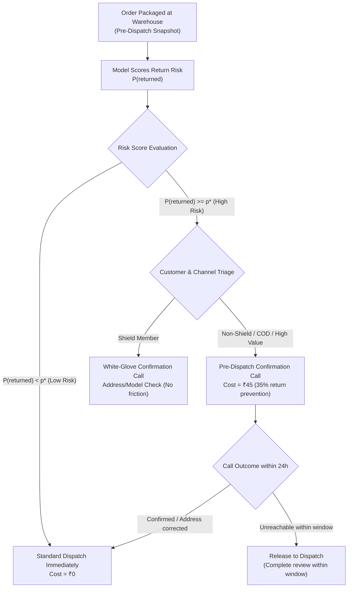

# Kestrel Home Appliances — Business Requirements & Economic Framework

## 1. Executive Context & Objectives

Kestrel Home Appliances manufactures and retails premium domestic appliances (Air Fryers, Induction Cooktops, Mixer Grinders, Ceiling Fans, Room Heaters, Water Purifiers, and Robot Vacuums) across direct-to-consumer (D2C) channels (Mobile App, Website), partner retail outlets, and online marketplaces.

Product returns impose a severe drain on unit economics, warehouse logistics, product depreciation, and customer goodwill. The primary objective is to develop a predictive machine learning system to score order return risk **at the warehouse dispatch stage** (prior to outbound shipment), enabling targeted operational interventions that prevent returns while protecting high-value customer relationships and avoiding dispatch delays.

---

## 2. Core Business Decisions Supported by the Model

At the moment an order reaches the warehouse packing station, operations must decide whether to dispatch immediately or trigger a pre-dispatch intervention. The model must output a well-calibrated return probability score $P(\text{returned} = 1)$ to support the following business decisions:

### Specific Operational Actions:
1. **Pre-Dispatch Confirmation Call (Outsourced Calling)**:
   - Targeted outbound call to customer to verify delivery address, product model compatibility, delivery time slot, and order intent.
   - Prevents wrong-address deliveries, mismatched model purchases, and impulse-buy cancellations before the goods physically leave the hub.
2. **Payment Mode Friction / Re-verification**:
   - For high-risk Cash on Delivery (COD) orders, automated IVR or SMS payment link to convert COD to prepaid, or confirm physical presence and cash readiness.
3. **Pre-Booking of White-Glove Installation**:
   - For products requiring specialized installation (Water Purifiers, Robot Vacuums, Ceiling Fans), scheduling installation in tandem with delivery to prevent returns caused by setup frustration or lack of technician availability.
4. **Protection Against Holding Over-Delay**:
   - Operations must ensure that any pre-dispatch intervention resolves within **24 hours**. Holding an order past 24 hours induces a ~12% customer cancellation rate.

---

## 3. Financial Costs & Unit Economics (Operations Policy v4.1)

All cost parameters are extracted directly from *Kestrel Operations Policy v4.1 (§4, §6, §7)*:

| Parameter | Value | Source / Operational Context |
| :--- | :--- | :--- |
| **Average Cost of a Return** | **₹1,150** | Reverse logistics transit, QC inspection at hub, repacking, inventory write-down, and restocking (on top of the product refund itself). |
| **Cost of Pre-Dispatch Confirmation Call** | **₹45** | Cost per completed call through outsourced contact centre partner. |
| **Intervention Prevention Effectiveness** | **35%** | Pilot proven rate: confirmation calls before dispatch prevent ~35% of returns that would have otherwise occurred (corrects wrong model, wrong address, buyer's remorse). |
| **Order Holding Cancellation Risk** | **12%** | Probability that a customer cancels an order if held at dispatch for more than 24 hours. |
| **Blended Service Contact Cost** | **₹260** | Customer support ticket handling cost. |
| **Technician Visit Cost** | **₹540** | Physical technician service visit cost. |
| **Shield Member Share & Value** | **~20% orders** | Shield members account for ~20% of orders, have the highest Customer Lifetime Value (LTV), and receive free 30-day returns and free annual service. |

---

## 4. Economic Optimization: Optimal Decision Threshold ($p^*$)

Let:
- $C_{\text{return}} = ₹1,150$ (operational cost incurred if an order is returned)
- $C_{\text{call}} = ₹45$ (cost to perform pre-dispatch call)
- $\eta = 0.35$ (proportion of returns prevented by a call)
- $p = P(\text{returned} = 1)$ (predicted return probability of the order)

### Cost Expectations:
- **Expected Cost of Do-Nothing (Direct Dispatch)**:
  $$\mathbb{E}[\text{Cost}_{\text{dispatch}}] = p \times C_{\text{return}} = 1150 \cdot p$$
- **Expected Cost of Intervening (Call)**:
  $$\mathbb{E}[\text{Cost}_{\text{call}}] = C_{\text{call}} + (1 - \eta) \cdot p \cdot C_{\text{return}} = 45 + (1 - 0.35) \cdot 1150 \cdot p = 45 + 747.5 \cdot p$$

### Net Expected Cost Savings from Calling:
$$\Delta(p) = \mathbb{E}[\text{Cost}_{\text{dispatch}}] - \mathbb{E}[\text{Cost}_{\text{call}}] = (1150 \cdot p) - (45 + 747.5 \cdot p) = 402.5 \cdot p - 45$$

Calling is financially viable when the expected savings are strictly positive ($\Delta(p) > 0$):
$$402.5 \cdot p - 45 > 0 \implies p > \frac{45}{402.5} \approx 0.1118 \quad (11.18\%)$$

> [!IMPORTANT]
> **Economic Break-Even Threshold**: $p^* \approx 11.2\%$.
> Any order with a predicted return probability $p > 11.2\%$ yields positive net financial returns from an outsourced confirmation call, on operational return costs alone.
> When factoring in gross margin loss and refund depreciation, the return cost is even higher, making intervention even more favorable.

---

## 5. Critical Analysis of the "95% Accuracy" Target

The prompt raises whether a **95% accuracy target** is a sensible metric for this project. **It is emphatically not a sensible metric.**

### 1. Base Rate Distortion & The Dummy Classifier Fallacy
- In the deduplicated training set, the return rate is **11.42%** (non-returned rate is **88.58%**).
- A trivial, zero-intelligence dummy model that predicts $\hat{y} = 0$ (never return) for every single order achieves **88.58% accuracy** without identifying a single return or saving a single rupee.
- Moving from 88.6% to 95% accuracy in an imbalanced setting creates severe perverse incentives: a model could artificially maximize accuracy by predicting non-return on ambiguous cases, maximizing accuracy while failing to capture the vast majority of costly returns.

### 2. Radical Asymmetry in Misclassification Costs
Accuracy implicitly assumes a **1:1 symmetric loss matrix**:
- Penalty of a False Positive (calling a customer who would not have returned): ₹45.
- Penalty of a False Negative (failing to call a customer who returns): ₹402.50 in net preventable operational savings (or ₹1,150 gross return cost).

$$\text{Cost Ratio} = \frac{\text{False Negative Cost}}{\text{False Positive Cost}} = \frac{402.50}{45.00} \approx 8.94 : 1 \quad (\text{or } 25.56:1 \text{ gross})$$

Missing a return is roughly **9 to 25 times more detrimental** to business bottom-line than making an unnecessary ₹45 confirmation call. Any metric that penalizes both errors equally (like accuracy) produces an operationally destructive decision boundary.

### 3. Recommended Metric Hierarchy
Instead of raw accuracy, the ML engineering and business operations team must evaluate models on:

1. **Discrimination / Ranking Metrics (Threshold-Independent)**:
   - **PR-AUC (Average Precision)**: Primary metric for imbalanced classification; focuses entirely on the minority positive class (returns).
   - **ROC-AUC**: Evaluates ranking across all discrimination thresholds.
2. **Probability Calibration**:
   - **Brier Score** & **Log Loss**: Essential because the economic decision rule ($p > 11.18\%$) relies on the actual numerical value of $p$ reflecting true historical frequencies.
3. **Business Value / Net Financial Savings Metric**:
   - $\text{Net Savings} = \sum_{i \in \text{Called}} (0.35 \times 1150 \times y_i - 45)$ evaluated on the out-of-time holdout set.
4. **Precision@K & Recall@K / Cost-Constrained Capacity**:
   - Call centers have limited daily capacity (e.g., maximum 50 calls/day). Operations must optimize Precision and Recall at the operational call capacity cut-off.

---

## 6. Segment-Specific Policy Considerations

### Kestrel Shield Members (§6)
- Represent **22.15%** of orders in train.
- Return rate is **18.61%** (nearly double non-Shield members at 9.38%), driven by the 30-day free returns entitlement.
- **Critical Policy Requirement**: Shield members represent the **highest Lifetime Value (LTV)** segment. Operations must **never** treat high return risk among Shield members with cancellation friction or aggressive questioning.
- Pre-dispatch communication for Shield members must be framed as **white-glove VIP concierge support** (e.g., "Confirming your installation slot and delivery preferences") rather than return deterrence.
