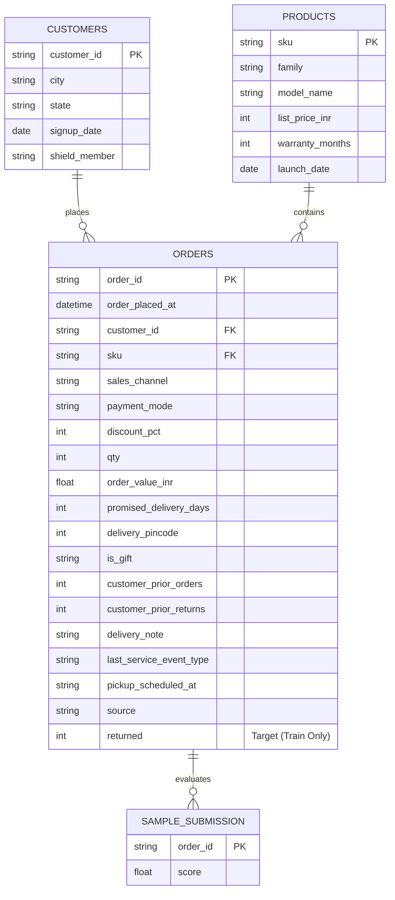
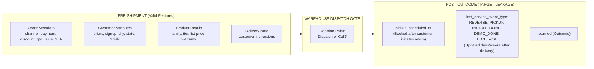

# Data Audit & Schema Integrity Report — Kestrel Home Returns Risk

## 1. File Inventory & Entity-Relationship Architecture

The dataset consists of 5 structured tabular files and operational documentation:

### Join Keys & Referential Integrity Verification
- **Orders $\to$ Customers**: Joined via `customer_id`.
  - Train: 6,131 unique customer IDs $\to$ **100% match** (0 missing in `customers.csv`).
  - Test: 1,878 unique customer IDs $\to$ **100% match** (0 missing in `customers.csv`).
  - Customer Overlap: 1,290 test customers (68.7% of test customer base) have prior history in `train.csv`.
- **Orders $\to$ Products**: Joined via `sku`.
  - Train: 21 unique SKUs $\to$ **100% match** (0 missing in `products.csv`).
  - Test: 21 unique SKUs $\to$ **100% match** (0 missing in `products.csv`).
- **Test $\to$ Sample Submission**: Joined via `order_id`.
  - Exactly 2,096 rows in `test_unlabelled.csv` match 1:1 with `sample_submission.csv` in identical sequence.

---

## 2. File-by-File Detailed Audit

### A. `train.csv`
- **Raw Row Count**: 11,155 rows, 19 columns.
- **Unique Order Count**: 10,504 orders.
- **Duplicate Rows**: 0 exact identical 19-column duplicates, but **651 duplicated order IDs** (1,302 rows) resulting from re-imported `partner_feed` records.
- **Target Distribution (`returned`)**:
  - Raw: Class 0 = 9,888 (88.64%), Class 1 = 1,267 (11.36%).
  - Deduplicated: Class 0 = 9,304 (88.58%), Class 1 = 1,200 (11.42%).
- **Date Range (`order_placed_at`)**: `2025-04-01 00:22` to `2026-06-30 23:08` (15 months: Q2 2025 – Q2 2026).

| Column Name | Dtype | Missing Count (%) | Unique Values | Description & Sample Values |
| :--- | :--- | :--- | :--- | :--- |
| `order_id` | object | 0 (0.0%) | 10,504 | Order unique identifier (e.g. `KO2600000`) |
| `order_placed_at` | object | 0 (0.0%) | 10,418 | Order timestamp (IST) |
| `customer_id` | object | 0 (0.0%) | 6,131 | Foreign key to `customers.csv` |
| `sku` | object | 0 (0.0%) | 21 | Foreign key to `products.csv` |
| `sales_channel` | object | 0 (0.0%) | 4 | `app` (3582), `marketplace` (2869), `web` (2766), `partner_outlet` (1287) |
| `payment_mode` | object | 0 (0.0%) | 4 | `prepaid_upi` (3921), `cod` (3152), `prepaid_card` (2153), `emi` (1278) |
| `discount_pct` | int64 | 0 (0.0%) | 52 | Checkout discount % (0% to 60%) |
| `qty` | int64 | 0 (0.0%) | 2 | Quantity (1 unit: 9881, 2 units: 623) |
| `order_value_inr` | float64 | 0 (0.0%) | 1,457 | Recorded transaction value in INR (**contains 100x bug in Oct 2025**) |
| `promised_delivery_days`| int64 | 0 (0.0%) | 12 | Promised delivery SLA in days (1 to 12 days) |
| `delivery_pincode` | int64 | 0 (0.0%) | 3,479 | 6-digit Indian PIN code; 848 rows (8.07%) are `000000` (walk-in orders) |
| `is_gift` | object | 0 (0.0%) | 2 | Gift flag: `N` (9778), `Y` (726) |
| `customer_prior_orders` | int64 | 0 (0.0%) | 11 | Historical orders prior to this transaction (0 to 10) |
| `customer_prior_returns`| int64 | 0 (0.0%) | 7 | Historical returns prior to this transaction (0 to 6) |
| `delivery_note` | object | 2,752 (24.7%) | 738 | Free text instructions typed by customer/outlet |
| `last_service_event_type`| object| 0 (0.0%) | 5 | **TARGET LEAKAGE** in train: `NONE`, `DEMO_DONE`, `INSTALL_DONE`, `REVERSE_PICKUP`, `TECH_VISIT` |
| `pickup_scheduled_at` | object | 9,855 (88.3%) | 1,229 | **TARGET LEAKAGE** in train: Logistics reverse-pickup booking timestamp |
| `source` | object | 0 (0.0%) | 2 | `crm` (10,504), `partner_feed` (651 re-imported duplicates) |
| `returned` | int64 | 0 (0.0%) | 2 | Binary target: 1 = returned, 0 = retained |

---

### B. `test_unlabelled.csv`
- **Row Count**: 2,096 rows, 18 columns.
- **Unique Order Count**: 2,096 unique orders (KO2610504 to KO2612599).
- **Duplicate Rows / IDs**: 0.
- **Date Range (`order_placed_at`)**: `2026-07-01 00:51` to `2026-09-30 23:46` (3 months: Q3 2026).
- **Operational Reality**: Represents the true pre-dispatch snapshot seen by warehouse dispatch staff.

| Column Name | Dtype | Missing Count (%) | Unique Values | Key Observations & Drift vs Train |
| :--- | :--- | :--- | :--- | :--- |
| `order_id` | object | 0 (0.0%) | 2,096 | Continuous sequential range after train orders |
| `order_placed_at` | object | 0 (0.0%) | 2,080 | Strictly out-of-time (July – Sept 2026) |
| `customer_id` | object | 0 (0.0%) | 1,878 | 1,290 repeat customers, 588 new customers |
| `sku` | object | 0 (0.0%) | 21 | All 21 SKUs present |
| `sales_channel` | object | 0 (0.0%) | 4 | Identical 4 channels |
| `payment_mode` | object | 0 (0.0%) | 4 | Identical 4 modes |
| `discount_pct` | int64 | 0 (0.0%) | 45 | Range: 0% to 51% |
| `qty` | int64 | 0 (0.0%) | 2 | 1 unit (1953), 2 units (143) |
| `order_value_inr` | float64 | 0 (0.0%) | 665 | Range: ₹1,367.43 to ₹57,020.16 (normal INR range, no 100x bug) |
| `promised_delivery_days`| int64 | 0 (0.0%) | 12 | Range: 1 to 12 days |
| `delivery_pincode` | int64 | 0 (0.0%) | 1,308 | 176 rows (8.40%) are `000000` |
| `is_gift` | object | 0 (0.0%) | 2 | `N` (1955), `Y` (141) |
| `customer_prior_orders` | int64 | 0 (0.0%) | 10 | Range: 0 to 9 |
| `customer_prior_returns`| int64 | 0 (0.0%) | 6 | Range: 0 to 5 |
| `delivery_note` | object | 538 (25.7%) | 231 | Similar missingness rate (25.7% vs 24.7% in train) |
| `last_service_event_type`| object| 0 (0.0%) | 2 | **CRITICAL SHIFT**: Only `NONE` (1553) and `INSTALL_BOOKED` (543)! None of the train events exist! |
| `pickup_scheduled_at` | float64| 2,096 (100.0%) | 0 | **100% NaN** (Unpopulated at dispatch) |
| `source` | object | 0 (0.0%) | 1 | 100% `crm` (0 `partner_feed` rows) |

---

### C. `customers.csv`
- **Row Count**: 9,000 rows, 5 columns.
- **Unique Primary Key**: `customer_id` (9,000 unique, 0 nulls, 0 duplicates).
- **Date Range (`signup_date`)**: `2022-10-15` to `2026-08-14`.
- **Shield Membership**: `N` = 7,001 (77.8%), `Y` = 1,999 (22.2%). Matches ops-policy §6 statement ("roughly a fifth of orders").
- **Geographic Coverage**:
  - 8 States: MH (2506), KA (1523), RJ (1025), MP (991), TS (985), TN (974), DL (534), UP (462).
  - 18 Tier-1 and Tier-2 Cities (Nashik, Delhi, Mumbai, Coimbatore, Hubballi, Indore, Kota, Warangal, Jaipur, Mysuru, Bengaluru, Nagpur, Pune, Hyderabad, Bhopal, Lucknow, Aurangabad, Chennai).

---

### D. `products.csv`
- **Row Count**: 21 rows, 6 columns.
- **Unique Primary Key**: `sku` (21 unique, 0 nulls, 0 duplicates).
- **Structure**: 7 product families $\times$ 3 tiers (`Lite`, `Pro`, `Max`).
- **List Price Range**: ₹1,999 (`KH-RH-01` Room Heater Lite) to ₹29,698 (`KH-RV-03` Robot Vacuum Max).
- **Warranty**: 12 months for 15 SKUs; 24 months for Mixer Grinders (3 SKUs) and Ceiling Fans (3 SKUs).
- **Launch Date**: `2023-05-27` to `2025-01-28`. All products were launched prior to or during train period.

---

### E. `sample_submission.csv`
- **Row Count**: 2,096 rows, 2 columns (`order_id`, `score`).
- **Keys**: Exactly matches `test_unlabelled.csv` `order_id`s.
- **Score format**: Float values representing predicted probability of return $[0.0, 1.0]$.

---

## 3. Pre-Shipment vs Post-Outcome Information Audit

### Severe Target Leakage & Covariate Shift Analysis:

1. **`pickup_scheduled_at` (100% Target Leakage)**:
   - In `train.csv`: Populated for 1,300 rows. When populated, **91.6%** (1,191 / 1,300) are `returned == 1`. When unpopulated, only **0.77%** (76 / 9,855) are returned.
   - In `test_unlabelled.csv`: **100.0% missing (NaN)**.
   - **Root Cause**: Policy §7 states: *"Once the return is approved, the logistics system books a reverse pickup and writes pickup_scheduled_at"*. At dispatch time, no return has occurred, so this field is naturally unpopulated.
   - **Remediation**: Must be **completely dropped** prior to feature engineering and training.

2. **`last_service_event_type` (Post-Outcome Contamination & Category Mismatch)**:
   - In `train.csv`, records reflect post-resolution system events months after delivery:
     - `REVERSE_PICKUP`: 750 orders $\to$ **100.0% returned** (perfect leakage).
     - `INSTALL_DONE`: 1,354 orders $\to$ **0.0% returned** (perfect leakage).
     - `DEMO_DONE`: 1,417 orders $\to$ **0.0% returned** (perfect leakage).
     - `TECH_VISIT`: 447 orders $\to$ 38.5% returned.
     - `NONE`: 6,536 orders $\to$ 4.25% returned.
   - In `test_unlabelled.csv`:
     - Only `NONE` (1,553) and `INSTALL_BOOKED` (543).
     - **None of the train events exist in test**, and **`INSTALL_BOOKED` does not exist in train**!
   - **Root Cause**: Train records reflect final state in CRM, where `INSTALL_BOOKED` transitioned into `INSTALL_DONE`, `DEMO_DONE`, or `REVERSE_PICKUP`. Test is a pre-dispatch snapshot where service visits haven't occurred yet.
   - **Remediation**: Must **not** be used as a raw categorical feature in training. The only pre-dispatch concept is whether an installation service was requested at booking.

---

## 4. Specific Data Anomalies & Root Causes

### 1. October 2025 CRM Migration 100x Currency Bug (Paise vs Rupees)
- **Anomaly**: Exactly 700 orders in `train.csv` (dated `2025-10-01 00:11` to `2025-10-31 22:17`) exhibit `order_value_inr` exactly **100.0x** higher than expected:
  $$\text{Ratio} = \frac{\text{order\_value\_inr}}{\text{list\_price\_inr} \times \text{qty} \times (1 - \text{discount\_pct}/100)} = 100.00 \quad (\sigma = 0.00)$$
- **Maximum Value**: Reaches ₹5,880,204.00 (₹58.8 Lakhs) for a single appliance!
- **Root Cause**: Policy §9 states: *"Until 30 Sep 2025 operations ran on Zoho Desk. From 1 Oct 2025 everything runs on Kestrel CRM."* During the first month of CRM cutover (October 2025), the payment gateway ingestion stored order amounts in **paise** rather than rupees. It was patched starting 1 November 2025.
- **Remediation**: Divide `order_value_inr` by 100.0 for orders between `2025-10-01` and `2025-10-31`, or impute from list price, quantity, and discount.

### 2. Partner Feed Re-import Duplicates (651 Duplicate Rows)
- **Anomaly**: Exactly 651 orders in `train.csv` appear twice (1,302 rows total). In every single case, one row has `source == 'crm'` and the other has `source == 'partner_feed'`, with identical values across all other 17 columns.
- **Root Cause**: Partner outlet feeds were re-imported into the CRM database in bulk without deduplication against existing CRM records.
- **Test Set Contrast**: `test_unlabelled.csv` contains 0 `partner_feed` rows (100% `crm`) and 0 duplicates.
- **Remediation**: Deduplicate `train.csv` on `order_id` (retaining the primary CRM record), reducing train from 11,155 to 10,504 rows.

### 3. Walk-in Partner Store Orders (`delivery_pincode == 000000`)
- **Anomaly**: 848 orders in train (8.07%) and 176 in test (8.40%) have `delivery_pincode == 0`.
- **Root Cause**: README specifies: *"000000 = system default when no address was captured (walk-in partner orders)"*.
- **Distribution**: These occur across channels (app, web, marketplace, partner_outlet) when customers pick up in-store or omit full postal dispatch addresses.
- **Remediation**: Treat pincode `0` as an explicit categorical indicator (`is_walkin_or_unaddressed = 1`) and group separately from geographic state/city pincodes.

### 4. Signup Date Preceding Order Date Anomalies
- **Anomaly**: 1,999 train orders and 18 test orders show `order_placed_at < signup_date`.
- **Root Cause**: Customers checking out as guests or purchasing via offline retail / marketplaces whose CRM accounts were created or backfilled at a later date.
- **Remediation**: Customer tenure must clamp negative values $(\text{order\_date} - \text{signup\_date})$ to 0 and flag `is_guest_or_backfilled = 1`.
