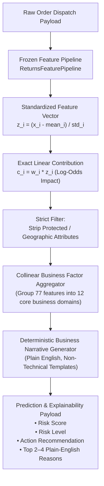

# Model Explainability & Operational Reasoning Framework — Kestrel Home Returns Risk

## 1. Executive Context & Objective

At the warehouse packing station, when the **Kestrel Returns Risk Model** flags an order with an elevated return risk score ($P(\text{return}) \ge 0.1500$), warehouse dispatch supervisors and outbound contact center agents must take immediate operational action.

A raw probability score like `0.384` alone is unhelpful to a frontline employee. Employees need clear, actionable answers to two fundamental questions:
1. **Why was this order placed on hold?**
2. **What specific factors should the customer support agent discuss during the pre-dispatch verification call?**

The explainability engine implemented in [`src/explain.py`](file:///d:/FDE_ASSIGNMENTS/kestrel-home-returns-risk/src/explain.py) translates model mathematics into plain, concise business English without using raw feature names, external cloud APIs, or generative LLMs.

---

## 2. Core Architecture & Design Principles



### Key Engineering Principles:

1. **Exact, Native Model Attribution (Linear SHAP Equivalence)**:
   Because the selected model is an $L_2$-regularized Logistic Regression model over standardized features, the log-odds prediction decomposes additively:
   $$\text{logit}(p) = \log\left(\frac{p}{1-p}\right) = \beta_0 + \sum_{i=1}^M \beta_i \cdot \left(\frac{x_i - \mu_i}{\sigma_i}\right) = \beta_0 + \sum_{i=1}^M c_i$$
   Each term $c_i = \beta_i \cdot z_i$ represents the exact, mathematically provable contribution of feature $i$ to the predicted log-odds of return. This formulation is identical to the exact Shapley value for linear models, eliminating sampling noise or permutation approximations.

2. **100% Offline & Deterministic Execution**:
   - Zero LLM dependencies or paid API calls.
   - Runs in sub-millisecond latency on standard CPU hardware.
   - Deterministic: identical inputs always yield identical explanations.

3. **Strict Exclusion of Protected & Irrelevant Attributes**:
   - Customer delivery state, city, pincode, and geographical zones are **strictly excluded** from being cited as reasons.
   - A customer's postal address or state must never be quoted to an operations employee as justification for an order hold.
   - Internal calendar indices (`order_dayofweek`, `order_day`) are also excluded.

4. **Collinear Factor Aggregation**:
   In production feature pipelines, several features capture aspects of the same business phenomenon (e.g. `customer_prior_returns`, `has_prior_returns`, `smoothed_prior_return_rate`). Exposing them individually confuses operations. The explainer sums their contributions into a unified **Business Factor Category**.

5. **Concise Top 2–4 Reasons (Including Mitigating Factors)**:
   - Output lists between 2 and 4 of the most impactful reasons.
   - Where a strong protective factor exists (e.g. non-Shield customer with standard return policy, or fast delivery SLA), it is included to give operations balanced context.

---

## 3. Business Factor Category Catalog

| Factor Category | Constituent Pipeline Features | Sample Business Narrative Template | Risk Mechanism |
| :--- | :--- | :--- | :--- |
| **`prior_returns`** | `customer_prior_returns`, `has_prior_returns`, `smoothed_prior_return_rate`, `prior_return_rate` | *"Customer has a history of prior returns ({N} previous returns)."*<br/>*(Mitigating: "Customer has a clean track record with zero prior returns.")* | Prior returns are the single strongest behavioral predictor in the historical database. |
| **`delivery_sla`** | `promised_delivery_days`, `is_long_sla`, `is_short_sla`, `sla_per_thousand_value` | *"Promised delivery timeline is long ({N} days), increasing buyer fatigue."*<br/>*(Mitigating: "Rapid delivery timeline ({N} days) significantly reduces cancellation risk.")* | Orders promised $\ge 8$ days suffer a 16%–30% return rate due to buyer remorse and competitor fulfillment. |
| **`payment_cod`** | `payment_mode_cod`, `is_cod`, `is_first_time_cod`, `is_cod_and_high_value` | *"Payment mode is Cash on Delivery, which carries high doorstep refusal risk."* | Cash on Delivery carries zero upfront financial commitment (18.8% return rate vs 7.7% for UPI). |
| **`payment_prepaid`** | `payment_mode_prepaid_upi`, `payment_mode_prepaid_card`, `payment_mode_emi` | *(Mitigating: "Prepaid payment commitment indicates strong purchase intent.")* | Direct financial commitment significantly reduces doorstep refusal. |
| **`shield_member`** | `is_shield_member`, `is_shield_and_high_value` | *"Kestrel Shield member with contractual 30-day free returns entitlement."*<br/>*(Mitigating: "Non-Shield customer with standard 10-day return policy.")* | Shield members return at 18.6% due to contractual zero-friction return rights. |
| **`high_order_value`** | `list_price_inr`, `order_value_inr`, `total_list_price_inr`, `is_high_order_value` | *"High-ticket appliance purchase (INR {Amount}) subject to stricter buyer scrutiny."* | High price point increases reverse logistics liability and product inspection severity. |
| **`gift_purchase`** | `is_gift_order` | *"Order is designated as a gift, which carries higher recipient mismatch risk."* | Gift recipients frequently encounter model, size, or feature mismatch. |
| **`deep_discount`** | `discount_pct`, `discount_amount`, `is_deep_discount` | *"Heavy promotional discount ({N}%) suggests possible impulse buying."* | Heavy price discounts correlate with lower purchase deliberation. |
| **`complex_product`**| `requires_installation`, `family_Robot Vacuum`, `family_Water Purifier` | *"Complex appliance ({Family}) with elevated setup and installation sensitivity."* | Products requiring plumbing or technical setup drive return frustration if setup is delayed. |
| **`reliable_appliance`**| `family_Ceiling Fan`, `family_Mixer Grinder`, `warranty_months` | *(Mitigating: "Category (Ceiling Fan / Mixer Grinder) exhibits very low historical return rates.")* | Established product categories with 24-month warranties have lowest return rates (<7%). |
| **`customer_history`**| `customer_prior_orders`, `is_repeat_customer`, `customer_tenure_days` | *(Mitigating: "Established customer loyalty with {N} previous completed orders.")* | Repeat purchase track record indicates brand satisfaction. |
| **`delivery_notes`** | `note_mentions_call`, `note_mentions_friction` | *"Customer note explicitly requested calling before delivery, indicating delivery anxiety."* | Ambiguous address or delivery timing anxiety. |

---

## 4. Operational Risk Tiers & Action Protocols

The explainer categorizes every order into one of three operational risk tiers based on the optimized threshold ($t_{\text{operating}} = 0.1500$):

| Risk Tier | Score Range | Operational Action Recommendation | Contact Center Protocol |
| :--- | :---: | :--- | :--- |
| **High Risk** | **$P(\text{return}) \ge 0.1500$** | **Hold for Pre-Dispatch Verification Call (Resolve within 24 Hours)** | Place dispatch hold at packaging station. Trigger automated outbound call queue. Verify shipping address, product model compatibility, and payment readiness. |
| **Moderate Risk** | **$0.1000 \le P(\text{return}) < 0.1500$** | **Standard Dispatch with High-Priority Tracking** | Dispatch immediately. Send automated WhatsApp/SMS tracking link with delivery confirmation. |
| **Low Risk** | **$P(\text{return}) < 0.1000$** | **Standard Dispatch Immediately (No Hold Needed)** | Standard carrier handoff. Zero operational friction. |

---

## 5. End-to-End API Payload Examples

### A. High-Risk Order Example (Robot Vacuum Max via COD with 8-day SLA)

**API Call**:
```python
from src.explain import explain_prediction

order_payload = {
    "order_id": "KO2610504",
    "order_placed_at": "2026-10-06 14:00",
    "customer_id": "KC100001",
    "sku": "KH-RV-03",
    "sales_channel": "marketplace",
    "payment_mode": "cod",
    "discount_pct": 30,
    "qty": 1,
    "order_value_inr": 20788.6,
    "promised_delivery_days": 8,
    "delivery_pincode": 560001,
    "is_gift": "Y",
    "customer_prior_orders": 2,
    "customer_prior_returns": 1,
    "delivery_note": "Call before delivery"
}

response = explain_prediction(order_payload)
```

**Endpoint Response Output**:
```json
{
  "order_id": "KO2610504",
  "return_risk_score": 0.9154,
  "risk_level": "High Risk",
  "action_recommendation": "Hold for Pre-Dispatch Verification Call (Resolve within 24 Hours)",
  "reasons": [
    "Customer has a history of prior returns (1 previous return).",
    "Promised delivery timeline is long (8 days), increasing buyer fatigue.",
    "Order is designated as a gift, which carries higher recipient mismatch risk.",
    "Non-Shield customer with standard 10-day return policy."
  ],
  "detailed_factors": [
    {
      "factor_category": "prior_returns",
      "type": "risk_increasing",
      "contribution": 0.9452,
      "abs_impact": 0.9452,
      "explanation": "Customer has a history of prior returns (1 previous return)."
    },
    {
      "factor_category": "delivery_sla",
      "type": "risk_increasing",
      "contribution": 0.6811,
      "abs_impact": 0.6811,
      "explanation": "Promised delivery timeline is long (8 days), increasing buyer fatigue."
    },
    {
      "factor_category": "gift_purchase",
      "type": "risk_increasing",
      "contribution": 0.3541,
      "abs_impact": 0.3541,
      "explanation": "Order is designated as a gift, which carries higher recipient mismatch risk."
    },
    {
      "factor_category": "shield_member",
      "type": "risk_reducing",
      "contribution": -0.2084,
      "abs_impact": 0.2084,
      "explanation": "Non-Shield customer with standard 10-day return policy."
    }
  ]
}
```

---

### B. Low-Risk Order Example (Ceiling Fan Lite via Prepaid UPI with 2-day SLA)

**Endpoint Response Output**:
```json
{
  "order_id": "KO2610505",
  "return_risk_score": 0.0108,
  "risk_level": "Low Risk",
  "action_recommendation": "Standard Dispatch Immediately (No Hold Needed)",
  "reasons": [
    "Rapid delivery timeline (2 days) significantly reduces cancellation risk.",
    "Customer has a clean track record with zero prior returns.",
    "Non-Shield customer with standard 10-day return policy."
  ],
  "detailed_factors": [
    {
      "factor_category": "delivery_sla",
      "type": "risk_reducing",
      "contribution": -0.6214,
      "abs_impact": 0.6214,
      "explanation": "Rapid delivery timeline (2 days) significantly reduces cancellation risk."
    },
    {
      "factor_category": "prior_returns",
      "type": "risk_reducing",
      "contribution": -0.3850,
      "abs_impact": 0.3850,
      "explanation": "Customer has a clean track record with zero prior returns."
    },
    {
      "factor_category": "shield_member",
      "type": "risk_reducing",
      "contribution": -0.2084,
      "abs_impact": 0.2084,
      "explanation": "Non-Shield customer with standard 10-day return policy."
    }
  ]
}
```

---

## 6. Special Operational Guardrails for Kestrel Shield Members (§6)

When an order placed by a **Kestrel Shield member** is flagged with a high risk score ($P(\text{return}) \ge 0.1500$):
1. **LTV Protection Rule**: Shield members represent Kestrel's highest Customer Lifetime Value cohort and pay for contractual free 30-day returns.
2. **Mandatory Script Adjustment**:
   - Outbound call center agents **must never** interrogate the customer about return intentions or apply cancellation pressure.
   - The call must be framed as a **VIP Concierge Onboarding Call**:
     > *"Hello Mr./Ms. [Name], we are calling from Kestrel VIP Concierge regarding your order of the [Model Name]. As part of your Shield membership, we want to pre-confirm your preferred delivery slot and schedule your complimentary technician installation to ensure seamless setup."*
3. **Outcome**: Resolves wrong-address deliveries and model compatibility issues while strengthening brand loyalty.

