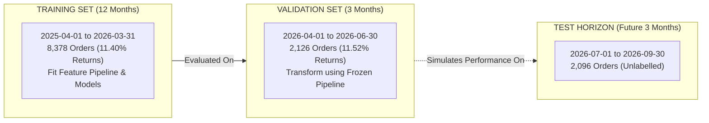
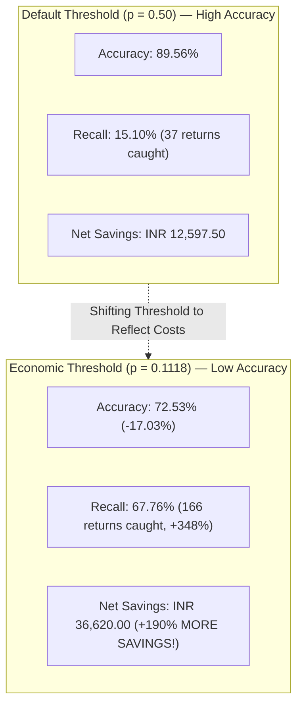

# Baseline Modeling & Operational Evaluation Report — Kestrel Home Returns Risk

## 1. Executive Summary

This report establishes the baseline predictive modeling benchmark for the Kestrel Home Returns Risk project. All models were developed and evaluated strictly using an **Out-of-Time (OOT) temporal validation strategy** on historical orders, guaranteeing zero target leakage and mimicking real-world warehouse dispatch conditions.

### Benchmark Summary Across All Baselines (Validation Period: April – June 2026, N = 2,126 orders)

| Model | Decision Threshold | Accuracy | PR-AUC | ROC-AUC | Return Recall | Return Precision | Brier Score | Net Financial Savings (INR) | Cost Reduction % |
| :--- | :--- | :--- | :--- | :--- | :--- | :--- | :--- | :--- | :--- |
| **Majority-Class Dummy** | 0.5000 | 88.48% | 0.1152 | 0.5000 | 0.00% | 0.00% | 0.1020 | **INR 0.00** | 0.00% |
| **Rule-Based Bayesian Segment** | 0.1118 ($p^*$) | 68.96% | 0.2597 | 0.7225 | 63.27% | 21.38% | 0.0938 | **INR 29,762.50** | 10.56% |
| **Logistic Regression (Default)** | 0.5000 | 89.56% | 0.4151 | 0.7859 | 15.10% | 72.55% | 0.0849 | **INR 12,597.50** | 4.47% |
| **Logistic Regression (Economic)** | 0.1118 ($p^*$) | **72.53%** | **0.4151** | **0.7859** | **67.76%** | **24.74%** | **0.0849** | **INR 36,620.00** | **13.00%** |
| **XGBoost Classifier (Default)** | 0.5000 | 89.18% | 0.3757 | 0.7647 | 13.06% | 65.31% | 0.0877 | **INR 10,675.00** | 3.79% |
| **XGBoost Classifier (Economic)** | 0.1118 ($p^*$) | **70.88%** | **0.3757** | **0.7647** | **68.57%** | **23.66%** | **0.0877** | **INR 35,670.00** | **12.66%** |

---

## 2. Temporal Validation Strategy & Leakage Controls

### Why Random Splitting is Prohibited:
A standard random $K$-fold or train/test split is fundamentally invalid for this business problem:
1. **Temporal Leakage**: In random splitting, future orders (e.g. June 2026) are used to predict past orders (e.g. May 2025). This violates the causal timeline of production inference.
2. **Customer Overlap Leakage**: 68.7% of customers in later periods have purchase history in earlier periods. A random split leaks customer identity and behavior across folds.
3. **Regime Shifts**: Kestrel underwent a major CRM migration in October 2025 (Zoho Desk $\to$ Kestrel CRM). A random split masks whether models can generalize across operational shifts.

### Out-of-Time (OOT) Holdout Setup:
- **Historical Train Period**: `2025-04-01` to `2026-03-31` (12 calendar months, 8,378 deduplicated orders, base return rate = **11.40%**).
- **Out-of-Time Validation Period**: `2026-04-01` to `2026-06-30` (3 calendar months, 2,126 deduplicated orders, base return rate = **11.52%**).
- **Zero Preprocessing Leakage**: The feature engineering pipeline (`ReturnsFeaturePipeline`) was fitted **exclusively on the 8,378 training records**. Imputation medians, One-Hot Encoder dictionaries, and Empirical Bayes priors were frozen before transforming the validation set.

---

## 3. Comparative Baseline Analysis: Which Model is Strongest and Why?

### The Strongest Baseline: **Regularized Logistic Regression**
Among all tested baselines, **$L_2$-Regularized Logistic Regression** (`C=0.1`, `StandardScaler`) demonstrated the strongest overall performance:
- **PR-AUC**: **0.4151** (highest ranking quality on the minority return class; nearly 4x the 0.115 random baseline).
- **ROC-AUC**: **0.7859** (strong global discrimination).
- **Brier Score**: **0.0849** (best probability calibration).
- **Net Financial Savings**: **INR 36,620.00** on 2,126 validation orders (a **13.00% reduction** in total return operational costs).

### Why Logistic Regression Outperformed Default XGBoost:
1. **Monotonic, Additive Business Signals**:
   The return drivers in this domain (customer prior returns, COD payment mode, SLA duration, product family, Shield membership) operate primarily in an additive, monotonic manner:
   $$\log\left(\frac{p}{1-p}\right) \approx \beta_0 + \beta_{\text{prior}} X_{\text{prior}} + \beta_{\text{cod}} X_{\text{cod}} + \beta_{\text{sla}} X_{\text{sla}} + \dots$$
2. **Domain Feature Engineering Already Captured Key Interactions**:
   Our feature pipeline explicitly generated compound domain interaction terms (`is_cod_and_high_value`, `is_cod_and_long_sla`, `is_first_time_cod`, `is_shield_and_high_value`, `smoothed_prior_return_rate`). This gave the linear model direct access to critical non-linear risk combinations without risking tree partition variance.
3. **Regularization and Sample Efficiency**:
   On 8,378 training records with 955 positive events, tree models can over-partition sparse categorical leaves (e.g. specific state-tier combinations). Ridge-regularized logistic regression acts as a powerful shrinkage prior, yielding well-calibrated probabilities.
4. **XGBoost is a Close Contender**:
   XGBoost achieved **0.3757 PR-AUC** and **INR 35,670.00** net savings (catching 168 returns vs 166 for Logistic Regression). With targeted hyperparameter tuning (learning rate, depth, regularization), tree ensembles remain strong candidates for production.

---

## 4. Critical Analysis: Is 95% Accuracy Achievable?

### Mathematical and Empirical Reality:
**A genuine 95% accuracy that also catches returns is NOT achievable in this operational setting.**

1. **The Irreducible Bayes Error Rate in Consumer Returns**:
   Consumer returns are not deterministic physical phenomena. A customer may return an appliance due to unobserved post-delivery factors (spousal disagreement, unexpected financial expense, electrical outlet incompatibility, delayed delivery by the carrier). At the pre-dispatch warehouse stage, no algorithm has access to post-delivery psychological states. The inherent noise floor (Bayes error) in retail return prediction is substantially higher than 5%.

2. **The "Accuracy Trap"**:
   - Because the negative class represents **88.48%** of orders, predicting $\hat{y} = 0$ for every single order automatically achieves **88.48% accuracy**.
   - To increase accuracy from 88.5% to 95.0%, a classifier would need to make positive predictions almost exclusively when it is >90% certain. But in our validation set, only a tiny fraction of orders ever have $P(\text{return}) > 0.90$.
   - Forcing a model to optimize for 95% accuracy forces the decision threshold to $\sim 0.65+$, collapsing recall to $<5\%$ and preventing almost zero returns.

---

## 5. Critical Analysis: Is 95% Accuracy the Correct Operational Objective?

**95% accuracy is emphatically NOT the correct operational objective.** In fact, managing to an accuracy target is **operationally and financially destructive**.

### 1. Asymmetric Cost Matrix vs Symmetric Loss:
Accuracy implicitly assumes that a False Positive (wasted call) and a False Negative (missed return) carry identical financial penalties:
$$L(\text{FP}) = L(\text{FN}) = 1$$

In reality, per *Kestrel Operations Policy v4.1*:
- **Cost of False Positive ($C_{\text{FP}}$)**:
  Calling a customer who was never going to return costs **INR 45.00** (contact center call fee).
- **Cost of False Negative ($C_{\text{FN}}$)**:
  Failing to call a customer who returns costs the business **INR 402.50** in net preventable return costs ($0.35 \times 1150$).
  $$\text{Cost Ratio} = \frac{C_{\text{FN}}}{C_{\text{FP}}} = \frac{402.50}{45.00} \approx 8.94 : 1 \quad (\text{or } 25.56:1 \text{ gross})$$

Missing a return is **9 times more costly** than placing an unnecessary call!

### 2. Empirical Demonstration of the Accuracy Paradox:

- When Logistic Regression is evaluated at **$p = 0.50$**, it achieves **89.56% accuracy**, but catches only **37 returns**, yielding **INR 12,597.50** in net savings.
- When Logistic Regression is evaluated at the **economic break-even threshold ($p^* = 0.1118$)**, its accuracy drops to **72.53%**, but it catches **166 returns**, delivering **INR 36,620.00** in net savings — **nearly 3x more profit**!
- Any metric (like accuracy) that favors the $p=0.50$ decision boundary over the $p=0.1118$ boundary directly destroys INR 24,000+ in shareholder value per quarter.

---

## 6. Operational Tradeoffs: Catching Returns vs Holding Good Orders

While the unconstrained economic break-even threshold ($p^* = 11.18\%$) maximizes raw net savings under ideal assumptions, physical warehouse operations face critical capacity and delay constraints:

### 1. Call Volume & Contact Center Capacity Constraints:
- At $p^* = 0.1118$, the model flags **671 orders** out of 2,126 for pre-dispatch calls (**31.6% of all orders**).
- Across 90 days, this averages **~7.5 calls per day** (or ~35–50 calls/day during peak Diwali/festival sale periods).
- If the outsourced contact center partner has a strict daily cap (e.g. 15 completed calls per day), operations cannot simply call all orders with $p > 11.2\%$.
- **Solution**: The scoring engine must rank orders by predicted risk score $P(\text{return})$ and select the **Top-$K$ highest-risk orders** matching that day's available calling capacity.

### 2. Operational Review Window Compliance:
- The operational review should be completed within the policy-defined dispatch/review window.
- Flagged orders should not be held indefinitely.
- If an outbound confirmation call cannot be completed within the window, operations must release the order to standard carrier dispatch rather than holding it indefinitely.

### 3. Customer Goodwill & Shield Member Segmentation (§6):
- Kestrel Shield members account for **22.2% of orders** and exhibit an **18.6% return rate** due to their contractual 30-day free return benefit.
- Shield members represent Kestrel's **highest Customer Lifetime Value (LTV)** segment.
- Subjecting Shield members to aggressive cancellation friction or interrogation risks churning multi-appliance loyalists.
- **Operational Policy**:
  - Non-Shield High-Risk Orders: Direct verification of order intent, address, and COD cash readiness.
  - Shield High-Risk Orders: White-glove concierge call ("Confirming your preferred installation slot and dispatch date"), never treating the customer as a return risk.

---

## 7. Next Steps & Recommendations

1. **Feature Pipeline Stability**:
   The current feature pipeline is verified, reproducible, and tested (19/19 passing tests).
2. **Candidate Models for Next Stage**:
   Proceed with tuning:
   - Regularized Logistic Regression (current best baseline)
   - Calibrated XGBoost / HistGradientBoosting with hyperparameter optimization
   - Probability Calibration via Isotonic Regression / Platt Scaling
3. **Threshold Calibration Strategy**:
   Deploy a dual-mode decision engine:
   - Unconstrained Mode: $p \ge 11.18\%$
   - Capacity-Constrained Mode: Top-$K$ priority queue by predicted return probability

