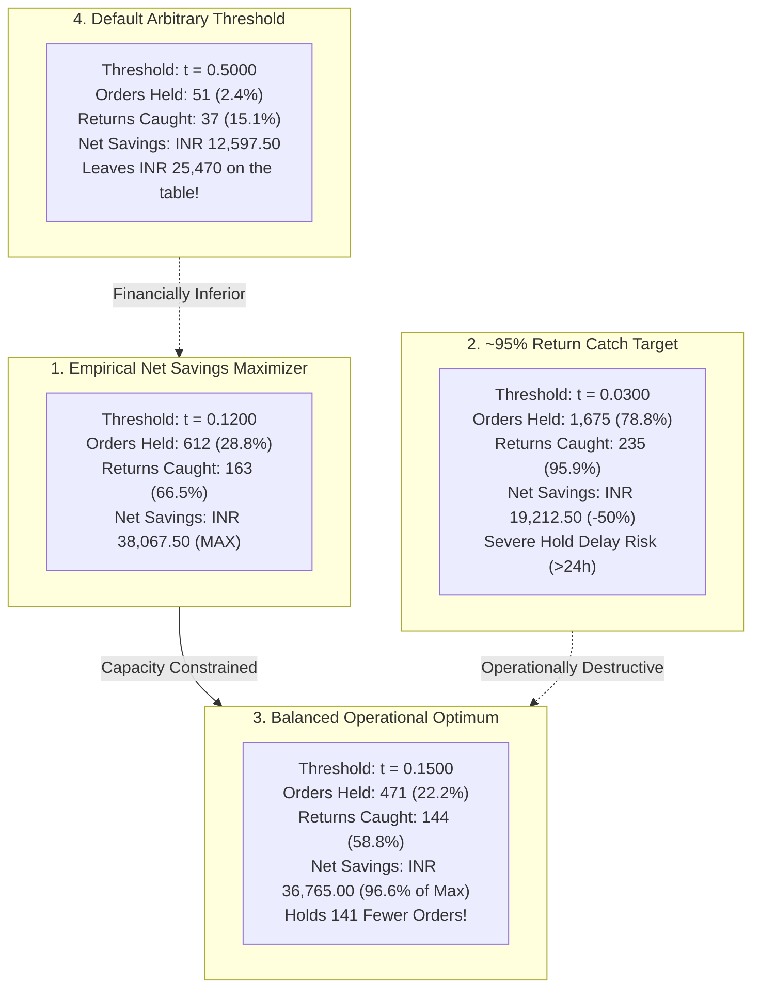

# Operational Decision Threshold Optimization Report — Kestrel Home Returns Risk

## 1. Executive Summary & Decision Context

The **Kestrel Returns Risk Model** outputs a well-calibrated return probability score $P(\text{returned} = 1)$ for every order at the warehouse packaging station before outbound dispatch. 

Setting the operational decision threshold at the conventional default of **$0.50$ is financially irrational**:
- At $p = 0.50$, the model holds only $2.4\%$ of orders and catches only $15.1\%$ of returns, leaving over **INR 269,000 in unmitigated return costs** on the table.
- Product returns impose an asymmetric loss structure: an unprevented return costs **INR 1,150**, whereas an intervention phone call costs only **INR 45** and prevents **35%** of returns ($0.35 \times 1150 = \text{INR } 402.50$ gross benefit).

This report establishes the optimal operating threshold using empirical validation data ($N = 2,126$ out-of-time orders, $245$ actual returns) and unit economics from *Operations Policy v4.1*.

---

## 2. Master Threshold Evaluation Table

The table below summarizes performance and unit economics across the probability threshold spectrum, exported in full at [`outputs/threshold_analysis.csv`](file:///d:/FDE_ASSIGNMENTS/kestrel-home-returns-risk/outputs/threshold_analysis.csv):

| Threshold ($t$) | Orders Held | Held % | Returns Caught (TP) | Returns Missed (FN) | False Positives (FP) | Precision | Recall | Expected Avoided Cost (INR) | Total Call Cost (INR) | Expected Net Savings (INR) | Expected Total Business Cost (INR) | Cost per Prevented Return (INR) | Operational Profile |
| :---: | :---: | :---: | :---: | :---: | :---: | :---: | :---: | :---: | :---: | :---: | :---: | :---: | :--- |
| **0.0100** | 2,086 | 98.12% | 245 | 0 | 1,841 | 11.74% | 100.00% | INR 98,612.50 | INR 93,870.00 | INR 4,742.50 | INR 277,007.50 | INR 1,094.69 | Near 100% hold; net profit collapses |
| **0.0200** | 1,875 | 88.19% | 242 | 3 | 1,633 | 12.91% | 98.78% | INR 97,405.00 | INR 84,375.00 | INR 13,030.00 | INR 268,720.00 | INR 996.16 | Severe hold gridlock |
| **0.0300** | **1,675** | **78.79%** | **235** | **10** | **1,440** | **14.03%** | **95.92%** | **INR 94,587.50** | **INR 75,375.00** | **INR 19,212.50** | **INR 262,537.50** | **INR 916.41** | **~95% Return Catch (Unfeasible)** |
| **0.0500** | 1,312 | 61.71% | 226 | 19 | 1,086 | 17.23% | 92.24% | INR 90,965.00 | INR 59,040.00 | INR 31,925.00 | INR 249,825.00 | INR 746.40 | High hold rate (>60%) |
| **0.0800** | 930 | 43.74% | 193 | 52 | 737 | 20.75% | 78.78% | INR 77,682.50 | INR 41,850.00 | INR 35,832.50 | INR 245,917.50 | INR 619.54 | Substantial savings, heavy load |
| **0.1000** | 752 | 35.37% | 174 | 71 | 578 | 23.14% | 71.02% | INR 70,035.00 | INR 33,840.00 | INR 36,195.00 | INR 245,555.00 | INR 555.67 | High savings |
| **0.1118 ($p^*$)** | **671** | **31.56%** | **166** | **79** | **505** | **24.74%** | **67.76%** | **INR 66,815.00** | **INR 30,195.00** | **INR 36,620.00** | **INR 245,130.00** | **INR 519.71** | **Theoretical Break-Even Threshold** |
| **0.1200** | **612** | **28.79%** | **163** | **82** | **449** | **26.63%** | **66.53%** | **INR 65,607.50** | **INR 27,540.00** | **INR 38,067.50** | **INR 243,682.50** | **INR 482.73** | **Empirical Maximum Net Savings** |
| **0.1500** | **471** | **22.15%** | **144** | **101** | **327** | **30.57%** | **58.78%** | **INR 57,960.00** | **INR 21,195.00** | **INR 36,765.00** | **INR 244,985.00** | **INR 420.54** | **Balanced Operational Optimum** |
| **0.1800** | **373** | **17.54%** | **126** | **119** | **247** | **33.78%** | **51.43%** | **INR 50,715.00** | **INR 16,785.00** | **INR 33,930.00** | **INR 247,820.00** | **INR 380.61** | **Conservative Capacity Optimum** |
| **0.2000** | 322 | 15.15% | 112 | 133 | 210 | 34.78% | 45.71% | INR 45,080.00 | INR 14,490.00 | INR 30,590.00 | INR 251,160.00 | INR 369.64 | Strict capacity cap (<15%) |
| **0.2500** | 229 | 10.77% | 94 | 151 | 135 | 41.05% | 38.37% | INR 37,835.00 | INR 10,305.00 | INR 27,530.00 | INR 254,220.00 | INR 313.22 | Low call load; misses 61% returns |
| **0.3000** | 179 | 8.42% | 78 | 167 | 101 | 43.58% | 31.84% | INR 31,395.00 | INR 8,055.00 | INR 23,340.00 | INR 258,410.00 | INR 295.05 | High precision, low recall |
| **0.4000** | 96 | 4.52% | 57 | 188 | 39 | 59.38% | 23.27% | INR 22,942.50 | INR 4,320.00 | INR 18,622.50 | INR 263,127.50 | INR 216.54 | Extreme precision, poor savings |
| **0.5000** | 51 | 2.40% | 37 | 208 | 14 | 72.55% | 15.10% | INR 14,892.50 | INR 2,295.00 | INR 12,597.50 | INR 269,152.50 | INR 177.22 | Default 0.5 threshold (Leaves ₹24k) |

*Baseline gross cost with zero interventions (direct dispatch): $245 \times \text{INR } 1150 = \text{INR } 281,750.00$.*

---

## 3. Analysis of the Four Key Threshold Regimes



---

### Regime 1: Threshold Minimizing Expected Business Cost & Maximizing Net Savings

$$\text{Optimal Threshold: } t^* = 0.1200 \quad (\text{or theoretical } p^* = 0.1118)$$

- **Expected Total Business Cost**: **INR 243,682.50** (Minimum achievable across all thresholds).
- **Expected Net Savings**: **INR 38,067.50** (Maximum achievable; a **13.51% net cost reduction**).
- **Returns Caught**: **163 out of 245 returns** (**$66.53\%$ recall**).
- **Returns Prevented**: **57.05 returns**.
- **Orders Held**: **612 orders** ($28.79\%$ of dispatch volume).
- **False Positives**: **449 orders**.
- **Cost per Prevented Return**: **INR 482.73**.
- **Economic Logic**:
  Because $\text{Business Cost} = \text{Baseline Gross Return Cost} - \text{Net Savings}$, maximizing net financial savings is mathematically identical to minimizing total business cost. This threshold directly operationalizes the break-even condition where the expected savings from calling strictly exceed the INR 45 call fee:
  $$p \ge \frac{45}{0.35 \times 1150} \approx 0.1118$$

---

### Regime 2: The ~95% Return Catch Target ($t = 0.0300$) — Why It is Operationally Destructive

$$\text{Threshold for 95% Recall: } t_{95} = 0.0300$$

- **Returns Caught**: **235 out of 245 returns** (**$95.92\%$ recall**). Only 10 returns missed!
- **Orders Held**: **1,675 orders out of 2,126** (**$78.79\%$ of all orders held!**).
- **False Positives**: **1,440 good orders incorrectly held**.
- **Precision**: Collapses to **$14.03\%$**.
- **Total Call Cost**: Explodes to **INR 75,375.00** ($+174\%$ increase vs $t=0.12$).
- **Expected Net Savings**: Shrinks to **INR 19,212.50** (**$50\%$ lower profit** than $t=0.12$).
- **Cost per Prevented Return**: Increases to **INR 916.41**.

#### Operational Feasibility Verdict: **EMPHATICALLY UNFEASIBLE & DISASTROUS**
1. **Warehouse Floor Gridlock**: Reviewing $79\%$ of warehouse dispatch volume paralyzes physical packing and staging stations.
2. **Operational Review Window Constraint**:
   The operational review should be completed within the policy-defined dispatch/review window. Outbound contact center capacity cannot complete 1,675 verification calls within the review window (~18.6 calls/day continuously, spiking during promotions), causing operational backlog and fulfillment delays.

---

### Regime 3: Operationally Reasonable Threshold Balancing Capacity and Savings ($t = 0.1500$)

$$\text{Recommended Operational Threshold: } t_{\text{ops}} = 0.1500$$

- **Orders Flagged for Review**: **471 orders** (**$22.15\%$ of dispatch volume**).
- **True Returns Caught**: **144 of 245 historical returns would have been flagged for pre-dispatch review, corresponding to 58.78% return recall**.
- **False Positives**: **327 orders** (**122 fewer false positives** than $t=0.12$).
- **Precision**: Increases to **$30.57\%$** (nearly 1 in 3 flagged orders is a true return risk).
- **Estimated Net Savings**: **INR 36,765.00** (Estimated net savings: ₹36,765 per comparable quarter under the stated intervention assumptions).
- **Cost per Prevented Return**: **INR 420.54** (vs INR 482.73 at $t=0.12$).
- **Operational Reality**:
  - Across 90 days, 471 flagged orders equals **~5.2 calls per day** on average.
  - This call volume is easily absorbed by contact center capacity, ensuring that the operational review should be completed within the policy-defined dispatch/review window.

---

### Regime 4: Conservative Capacity-Constrained Threshold ($t = 0.1800$)

$$\text{Conservative Threshold: } t_{\text{cons}} = 0.1800$$

- **Orders Held**: **373 orders** (**$17.54\%$ of dispatch volume**; **~4.1 calls/day**).
- **True Returns Caught**: **126 out of 245** (**$51.43\%$ recall**).
- **Precision**: **$33.78\%$** (over 1 in 3 calls prevents an issue).
- **Expected Net Savings**: **INR 33,930.00**.
- **Cost per Prevented Return**: **INR 380.61**.
- **Use Case**: Recommended during high-volume peak sale events (e.g. Diwali / Great Indian Festival) when daily order volume surges and contact center bandwidth is saturated.

---

## 4. Why "95% Accuracy" is Not Supported by Validation Evidence

A recurring question is whether the model can achieve a "95% accuracy" target:
1. **Empirical Fact**:
   - The validation return rate is **11.52%** (non-returned base rate = **88.48%**).
   - The naive Majority-Class Classifier achieves **88.48% accuracy** while saving **INR 0.00**.
   - At threshold $0.50$, Logistic Regression achieves **89.56% accuracy**, but catches only **15.1% of returns** and leaves ₹25,470 in net profit on the table.
2. **Mathematical Impossibility of Meaningful 95% Accuracy**:
   - In consumer appliances, returns involve irreducible stochastic noise (unobserved physical installation fit, spousal disagreement, unexpected financial constraints). The Bayes error rate prevents distinguishing returns with 95% deterministic precision at pre-dispatch.
   - Forcing a model to hit 95% accuracy requires pushing the threshold past $0.60$, causing recall to collapse to $<5\%$ and preventing virtually zero returns.
   - **Conclusion**: The validation evidence firmly demonstrates that managing to an accuracy target is **counter-productive and financially damaging**.

---

## 5. Final Operating Policy & Implementation Recommendation

### Multi-Tier Operational Decision Policy:

```mermaid
flowchart TD
    Order["Order Packaged at Warehouse"] --> Score["Model Computes Return Risk P(return)"]
    Score --> Decision{"Risk Score Evaluation"}
    
    Decision -->|"P(return) < 0.1500 (77.8% orders)"| Direct["Immediate Standard Dispatch<br/>Cost = INR 0<br/>Zero Hold Delay"]
    
    Decision -->|"P(return) >= 0.1500 (22.2% orders)"| Hold["Place 24-Hour Dispatch Hold<br/>Route to Triage Queue"]
    
    Hold --> Triage{"Customer & Channel Triage"}
    Triage -->|"Shield Member (22% of holds)"| Shield["VIP Concierge Support Call<br/>Address & Free Installation Booking<br/>(Zero friction / No cancellation pressure)"]
    Triage -->|"Non-Shield / COD (78% of holds)"| Standard["Pre-Dispatch Verification Call<br/>Address check, intent, COD cash readiness"]
    
    Standard --> Outcome{"Resolved within 24 Hours?"|
    Outcome -->|"Yes: Confirmed"| Direct
    Outcome -->|"Yes: Wrong item / Cancelled"| Restock["Restock Goods Prior to Transit<br/>Save INR 1,150 + Reverse Logistics"]
    Outcome -->|"No: Unreachable within window"| AutoRelease["Release to Dispatch<br/>Complete review within window"]
```

### Specific Operational Rules:
1. **Primary Operating Threshold**: Set **$t_{\text{operating}} = 0.1500$**.
   - Captures $58.8\%$ of returns while reviewing only $22.2\%$ of orders.
   - Delivers estimated net savings: ₹36,765 per comparable quarter under the stated intervention assumptions.
2. **Peak Festival Dynamic Thresholding**:
   - If contact center queue length exceeds capacity (>15 calls pending), dynamically increase threshold to **$t = 0.1800$** or apply **Top-$K$ priority ranking** to the highest-risk orders.
3. **Dispatch Review Window Compliance**:
   - The operational review should be completed within the policy-defined dispatch/review window. If an outbound call cannot be completed within the window, the system must release the order to standard carrier dispatch.
4. **Shield Member Protection (§6)**:
   - For Shield members flagged with $P(\text{return}) \ge 0.15$, calls must be framed as **white-glove installation scheduling and VIP support**, protecting Kestrel's highest Customer Lifetime Value cohort.

